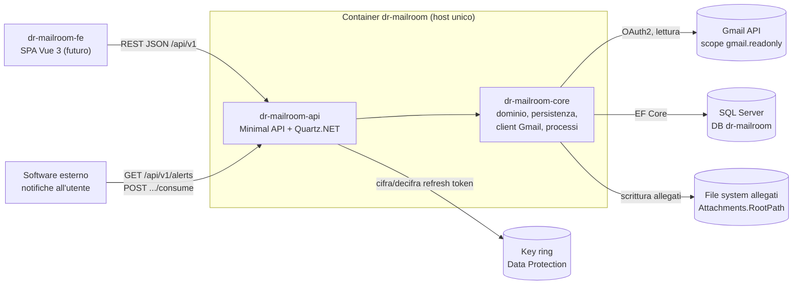
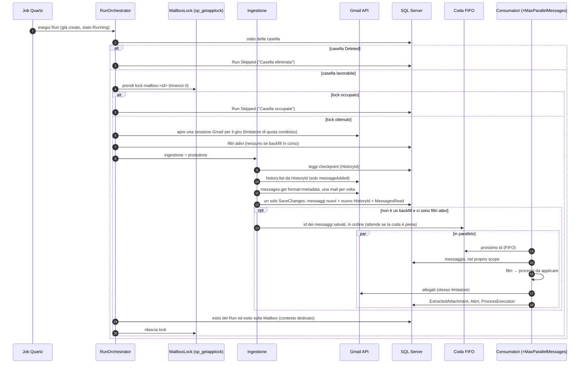
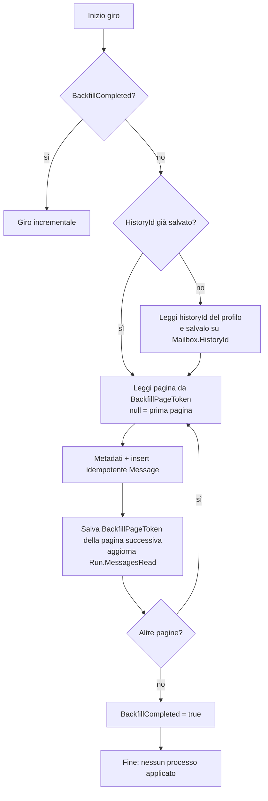
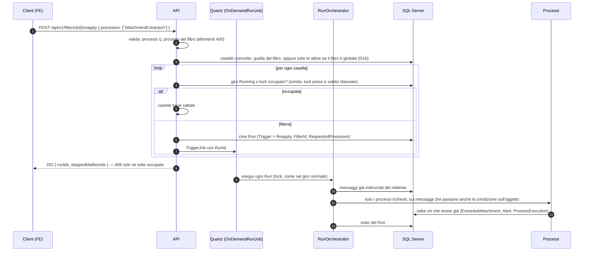
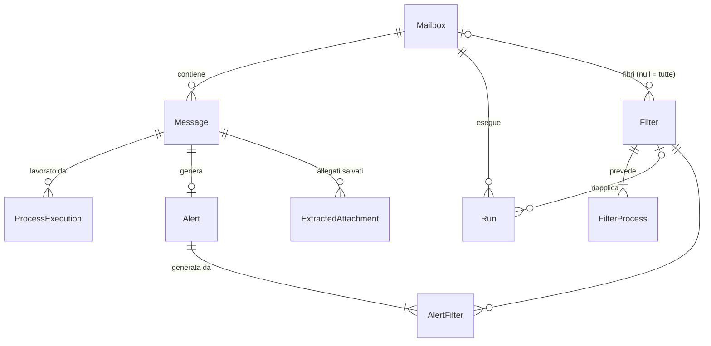

# Architettura di dr-mailroom

dr-mailroom è un servizio .NET che legge una o più caselle Gmail **in sola lettura**. Salva le statistiche per mittente e applica filtri sulle mail nuove. Le mail che passano un filtro vengono lavorate da uno o più processi: estrazione degli allegati e allerta.

Il servizio gira da solo secondo un cron configurabile. Un giro si può anche avviare a mano via API. Il frontend è un progetto separato: qui c'è solo la sua specifica ([frontend-specifiche.md](frontend-specifiche.md)).

Fonte delle decisioni: il piano `.ai/plans/2026-10-02-mailroom-gmail-reader/plan.md`, nato dal tavolo `/dr-warroom` del 2026-10-02 e dalle risposte del proprietario.

---

## Come sono fatti i componenti



| Componente | Ruolo |
|---|---|
| `dr-mailroom-api` | Host unico: espone le API REST, esegue lo scheduler Quartz, ospita la configurazione |
| `dr-mailroom-core` | Libreria: entità e provider EF Core, client Gmail, ingestione, motore dei filtri, processi, orchestrazione dei giri |
| `dr-mailroom-tests` | Test xUnit della libreria e degli endpoint |
| SQL Server | Istanza esistente; contiene caselle, messaggi indicizzati, filtri, giri, allerte |
| File system allegati | Cartella radice configurabile, montata come volume nel container |
| Key ring Data Protection | Chiavi che cifrano i refresh token; su volume, **fuori** dal database |
| `dr-mailroom-fe` | SPA futura, in un proprio container nginx |
| Software esterno | Legge le allerte non consumate e avvisa l'utente; fuori scope |

---

## Le decisioni del proprietario (D1–D18)

| # | Tema | Decisione |
|---|------|-----------|
| D1 | Caselle | Più caselle Gmail. Tabella `Mailbox`, token e checkpoint per casella, parallelismo per casella |
| D2 | Storico | Il primo giro legge **tutto lo storico**: backfill completo, avanzamento visibile, riprendibile dopo un'interruzione |
| D3 | Allerte | **Una allerta per mail**, anche se più filtri la intercettano. L'allerta elenca i filtri che l'hanno generata. Il software esterno la marca come consumata (`ConsumedAtUtc`) |
| D4 | Filtro oggetto | Mittente obbligatorio e **al massimo una** condizione sull'oggetto. Più condizioni → più filtri |
| D5 | Topologia | Host unico `dr-mailroom-api` + libreria `dr-mailroom-core` + `dr-mailroom-tests`: un solo container. Uno split futuro in API + Worker tocca solo l'host |
| D6 | Spam/Cestino | Esclusi dalla lettura (`includeSpamTrash=false`), configurabile |
| D7 | Match mittente | Uguaglianza case-insensitive sull'indirizzo |
| D8 | Match oggetto | Un solo tipo per filtro: `StartsWith`, `Contains` o `Regex`. I primi due case-insensitive. `Regex` con `IgnoreCase \| CultureInvariant` e timeout configurabile: timeout → nessun match + warning nel log |
| D9 | Statistiche | Contano **tutte** le mail lette, non solo quelle filtrate |
| D10 | Frontend | Niente Blazor né Razor. Il backend espone solo REST JSON. Il frontend `dr-mailroom-fe` è una SPA Vue 3 + Vite + TypeScript separata, servita da nginx. Qui: solo specifica |
| D11 | Giro manuale | `POST /api/v1/runs` avvia **subito** il giro. Casella con un giro già attivo → **409**. Nessuna coda nel DB |
| D12 | Backfill e filtri | Il backfill **solo indicizza** (statistiche): nessun processo sullo storico. I filtri valgono sulle mail nuove |
| D13 | Riapplica | `POST /api/v1/filters/{id}/reapply` lavora le mail **già indicizzate** che corrispondono al filtro, anche con un **sottoinsieme dei processi** (es. solo allegati, niente allerte sullo storico). Idempotente |
| D14 | Naming | Prefisso `dr-mailroom` + suffisso per ruolo: `-api`, `-core`, `-tests`, `-fe`. Solution `dr-mailroom.slnx`. Namespace generati `dr_mailroom_core` ecc. (trattino → underscore, regola `snake_case`) |
| D15 | Validazione dei body | Regole concordate campo per campo: mittente email valida, condizione sull'oggetto tutta presente o tutta assente, regex compilabile, almeno un processo, sottocartella relativa obbligatoria con l'estrazione allegati |
| D16 | Riapplica di un filtro globale | Un giro per ogni casella attiva; le caselle occupate si saltano e si segnalano; 409 solo se lo sono tutte |
| D17 | Giro manuale su tutte le caselle | `POST /api/v1/runs` senza casella crea un giro per ogni casella attiva, con la stessa logica di D16 |
| D18 | Rimozione di una casella | Solo logica: stato `Deleted` e refresh token cancellato. Niente più giri né modifiche ai suoi filtri (409); le statistiche restano. Un indirizzo eliminato non si può ricollegare |

---

## Le decisioni tecniche (T1–T12)

| # | Tema | Decisione |
|---|------|-----------|
| T1 | Accesso | Gmail API, non IMAP. OAuth2 con il solo scope `https://www.googleapis.com/auth/gmail.readonly`: lo stato letto/non letto non si può modificare per costruzione |
| T2 | Cartelle | In Gmail le "cartelle" sono **label**. Si legge per messaggio (`messageId`), non per cartella: nessun doppio conteggio. Le label si salvano come attributo del messaggio |
| T3 | Checkpoint | Backfill: `pageToken` salvato su `Mailbox.BackfillPageToken` dopo ogni pagina. L'`historyId` del profilo si cattura **all'inizio** del backfill e fa da base all'incrementale. Incrementale: `users.history.list` da `HistoryId`; HTTP 404 (history scaduta) → scansione completa idempotente |
| T4 | Idempotenza | UNIQUE `(MailboxId, GmailMessageId)`. Insert idempotenti: errori 2601/2627 = già presente. Mai chiave sul `Message-ID` dell'header |
| T5 | Statistiche | Viste SQL `vw_SenderStats` e `vw_SenderMonthlyStats`, colonna calcolata persistita `YearMonth`, indice coprente. `ReceivedAtUtc` viene da `internalDate` di Gmail |
| T6 | Segreti | Refresh token cifrati con ASP.NET Core Data Protection. Key ring su percorso configurabile (volume), fuori dal DB. Client secret da configurazione locale o ambiente. Token mai nei log applicativi |
| T7 | Scheduler | Quartz.NET con cron da configurazione. Job schedulato con `[DisallowConcurrentExecution]`. Giro manuale e riapplica con `TriggerJob` immediato su un job separato |
| T8 | Lock | Un giro alla volta per casella con `sp_getapplock`: risorsa `mailbox:<id>`, timeout 0, owner `Session` su una connessione dedicata aperta per tutto il giro. Casella occupata: il giro schedulato la salta (log), la richiesta manuale riceve 409 |
| T9 | Resilienza | Parallelismo per casella; per casella, produttore sequenziale verso Gmail e coda FIFO bounded elaborata da `MaxParallelMessages` consumatori, ognuno con il proprio scope. Limitatore di quota (token bucket, `QuotaUnitsPerMinute`) per sessione, condiviso da produttore e consumatori. Retry con backoff esponenziale su 5xx (1, 2, 4, 8 s) e su quota superata, 429 o 403 `rateLimitExceeded`/`userRateLimitExceeded` (10, 20, 40, 80 s) |
| T10 | Allegati | Root configurabile + sottocartella per filtro, relativa alla root (niente path assoluti dall'utente). Nome `yyyyMMdd-HHmmss_<mittente>_<nomefile>` sanificato, senza path traversal, con suffisso numerico su collisione. Limite di dimensione. SHA-256. UNIQUE `(MessageId, PartId)`: un allegato non si scrive mai due volte |
| T11 | Database | SQL Server esistente, EF Core con migration. Nessun trigger, nessuna stored procedure custom (`sp_getapplock` è di sistema) |
| T12 | Google Cloud | App OAuth pubblicata **"In production"** (non verificata, uso personale): in "Testing" il refresh token scade dopo 7 giorni. `invalid_grant` → `Mailbox.Status = TokenRevoked` + `LastError` visibile |

---

## Le convenzioni dei pacchetti dr-* (C1–C12)

Vengono dalle istruzioni dei pacchetti `dr-minimalapi`, `dr-efdb` e `dr-guidelines`, applicate in Fase 3.

| # | Tema | Decisione |
|---|------|-----------|
| C1 | URL | Endpoint sotto `api/v{version:apiVersion}/<gruppo>` (oggi `v1`), definiti in `Endpoints/*Mapping.cs`, con metadata OpenAPI completi. Documentazione con Scalar, non Swagger UI |
| C2 | Callback OAuth | Versionato: `http://localhost:5180/api/v1/mailboxes/connect/callback`. Va registrato identico in Google Console |
| C3 | Persistenza | In `dr-mailroom-core/Infrastructure/Mailroom/`: `MailroomDbContext` (NoTracking di default), un provider per area (`MailboxProvider`, `FilterProvider`, `MessageProvider`, `RunProvider`, `AlertProvider`, `StatsProvider`), `Entities/` con `[Table]` e `[Column]`, `Configurations/` (chiavi, indici, CHECK), `Filters/`, `Migrations/` |
| C4 | SQL logging | `EnableSensitiveDataLogging` attivo, come da istruzione e per scelta del proprietario. Effetto: i log di EF possono mostrare i valori dei parametri SQL, compreso il refresh token **cifrato**. I log applicativi non contengono mai il token |
| C5 | Layer API | Handler → `Services/<Area>Service.cs` → provider. DTO completo + DTO ridotto con `Projection`. Le liste hanno filtro validato e variante `/summary`. Lista vuota → 404 ProblemDetails |
| C6 | Validazione | Interfaccia `IValidator<T>` propria (niente FluentValidation). Un validatore per ogni body e per ogni filtro |
| C7 | Salute | `/health`, `GET /api/v1/status`, `POST /api/v1/status/retry-database`. Con il DB giù l'API parte comunque, in stato degradato; gli errori DB a runtime diventano 503 |
| C8 | Autenticazione | Chiave API (`SimpleAuthenticationTools`): non ci sono utenti con login. Gli endpoint di stato restano anonimi |
| C9 | Stack | `Tinyhelpers.AspNetCore`, Scalar, `Asp.Versioning.Mvc.ApiExplorer`, Serilog su console e file giornaliero (`logs/`) con ThreadId e TaskId |
| C10 | Segreti locali | `appsettings.local.json`, ignorato da git, caricato da `Program.cs`: connection string, client secret Google, chiave API. Nel container: variabili d'ambiente |
| C11 | Data Protection | `PersistKeysToFileSystem` su volume: il key ring resta fuori dal DB (T6) |
| C12 | Debug | `.vscode/launch.json` e `tasks.json`, profili in `launchSettings.json`, file `.http` |

---

## Come funziona un giro

### Come il servizio decide di partire

Lo scheduler è Quartz.NET, registrato in `SchedulingExtensions.AddMailroomScheduling`. Parte insieme all'host come servizio hosted e conosce due job:

| Job | Quando parte | Cosa fa |
|---|---|---|
| `ScheduledRunJob` | a ogni scatto del cron `Mailroom:Schedule:Cron` (default `0 0/15 * * * ?`, ogni 15 minuti) | chiama `ScheduledRunner.RunAllAsync`: un giro per ogni casella attiva |
| `OnDemandRunJob` | solo quando `QuartzRunDispatcher` lo invoca con `TriggerJob`; non ha un trigger proprio | esegue il giro indicato dal `RunId` nel `JobDataMap` (giro manuale o riapplica) |

- `ScheduledRunJob` ha `[DisallowConcurrentExecution]`: se il giro precedente dura più di 15 minuti, lo scatto successivo aspetta invece di sovrapporsi.
- All'arresto del servizio, `WaitForJobsToComplete = true` fa aspettare la fine dei giri in corso.
- Per "casella attiva" si intende `Status = Active` con refresh token presente. Una casella `TokenRevoked` o `Deleted` esce dai giri automatici.
- Nessun job rilancia eccezioni: un errore finisce nel log e il cron riprova allo scatto successivo.

### Chi crea il giro

Un giro lavora **una casella**. Nasce in due modi:

| Origine | Chi crea il `Run` | Casella occupata |
|---|---|---|
| **Cron** (`ScheduledRunJob`) | `ScheduledRunner`, uno per ogni casella attiva, in parallelo fino a `MaxParallelMailboxes`, ognuno nel proprio scope | il giro parte e chiude come `Skipped` |
| **Manuale** (`POST /api/v1/runs`) | `RunService`, che poi lo affida a Quartz (`OnDemandRunJob`) e risponde subito 202 | l'API risponde **409** prima di creare il `Run`: trova un giro `Running` oppure il lock già preso |

La catena delle classi, dalla partenza all'orchestratore:

```text
cron ──► ScheduledRunJob ──► ScheduledRunner ─────────────────────────────────┐
                              (crea un Run Scheduled per ogni casella attiva)  │
POST /api/v1/runs ──► RunService ──► QuartzRunDispatcher ──► OnDemandRunJob ──┤
                      (sonda casella occupata, crea Run Manual, 202)          ▼
                                                        RunOrchestrator.ExecuteAsync(runId)
```

### Cosa succede dentro il giro

Da lì in poi il percorso è lo stesso:



Regole che valgono in ogni giro:

- **Checkpoint insieme ai messaggi.** Messaggi nuovi, nuovo `HistoryId` e contatore `MessagesRead` si salvano in un unico `SaveChanges`: passano tutti o nessuno. Se una lettura da Gmail fallisce prima, il checkpoint resta quello vecchio e il giro successivo rilegge gli stessi messaggi; l'insert idempotente evita i duplicati.
- **Esito scritto a parte.** Esito del giro e stato della casella si scrivono con un contesto EF nuovo. Così un errore lasciato a metà nel contesto del giro (per esempio un `HistoryId` già avanzato in memoria) non viene salvato per sbaglio.
- **History scaduta (HTTP 404)** → scansione completa idempotente della casella. Entrano solo i messaggi mancanti, che poi passano dai filtri.
- **Una casella in errore non ferma le altre.** `invalid_grant` porta la casella in `TokenRevoked`.
- **Processi solo sui messaggi inseriti ora**, mai su quelli già presenti. Un processo che fallisce su un messaggio registra `Failed` in `ProcessExecution` e il giro prosegue.
- **Produttore e consumatori separati.** L'ingestione legge Gmail una mail per volta e mette gli id salvati in una coda FIFO bounded (`MessageProcessingQueue`); i consumatori la svuotano in parallelo, ognuno con il proprio scope DI. Se il produttore fallisce, i consumatori finiscono i messaggi già in coda e poi il giro chiude `Failed`; un errore fatale di un consumatore (per esempio `invalid_grant`) annulla tutto. La riapplica usa la stessa coda, con i candidati letti da DB come produttore.
- **Nomi file contesi.** Due consumatori che salvano allegati con lo stesso nome deterministico ricalcolano il suffisso `_N` e riprovano la rinomina.
- **Riavvio del servizio.** All'avvio i giri rimasti `Running` per un arresto brusco vengono chiusi come `Failed`, così la casella non resta bloccata.

### Come si chiude un giro

| Esito | Stato del `Run` | Effetto sulla casella |
|---|---|---|
| Lavoro finito, anche con processi falliti su qualche messaggio | `Completed`, con `MessagesRead`, `MessagesProcessed`, `ErrorCount` | esito pulito, `LastError` azzerato |
| Casella `Deleted` oppure lock già preso | `Skipped`, con il motivo in `ErrorSummary` | nessuno |
| Refresh token revocato (`invalid_grant`) | `Failed` | `Status = TokenRevoked`: la casella esce dai giri finché non si ricollega |
| Qualsiasi altro errore | `Failed`, con il messaggio in `ErrorSummary` | `LastError` valorizzato; il cron riprova al prossimo scatto |

In ogni caso il lock si rilascia alla fine del giro. Se il rilascio fallisce, lo libera comunque SQL Server quando chiude la connessione dedicata.

---

## Come funziona il backfill

È il primo giro su una casella (`BackfillCompleted = false`). Legge tutto lo storico e lo **indicizza soltanto** (D12): niente filtri, niente allegati, niente allerte.



- **Ripresa.** Se il giro si interrompe, il successivo riparte dal `BackfillPageToken` salvato, non da capo.
- **Nessun buco.** L'`historyId` è catturato **prima** di leggere la prima pagina: nessuna mail arrivata durante il backfill sfugge all'indicizzazione. Quelle che il backfill ha già letto, però, non passano dai filtri (vedi "Limiti noti").
- **Avanzamento visibile.** `Run.MessagesRead` si aggiorna durante il giro; il frontend lo mostra con il polling.

---

## Come funziona la riapplica di un filtro

Serve a lavorare lo storico **dopo** il backfill, in modo mirato (D13). Esempio: "scarica gli allegati di tutte le fatture del fornitore X, senza generare allerte".



- **Sottoinsieme dei processi.** Body `{ processes?: [...] }`; senza body valgono tutti i processi del filtro. Un processo che il filtro non ha → 400.
- **Vale anche per un filtro disattivato**: la riapplica è una richiesta esplicita. Non vale su una casella `Deleted` (409).
- **Idempotente.** Rilanciarla non scrive allegati due volte e non crea allerte nuove. Su un'allerta esistente aggiunge solo il collegamento `AlertFilter` al filtro.

---

## Modello dati

| Tabella | Colonne chiave | Vincoli e indici |
|---------|----------------|------------------|
| `Mailbox` | EmailAddress, EncryptedRefreshToken, HistoryId (`decimal(20,0)`), BackfillPageToken, BackfillCompleted, Status (Active / TokenRevoked / Disabled / Deleted), LastRunAtUtc, LastError | UNIQUE(EmailAddress) |
| `Message` | MailboxId, GmailMessageId, ThreadId, SenderAddress (minuscolo), SenderName, Subject, ReceivedAtUtc, `YearMonth` (`int` calcolato persistito: `YEAR*100+MONTH`, es. 202610), Labels, HasAttachments | UNIQUE(MailboxId, GmailMessageId); IX(MailboxId, SenderAddress, YearMonth) |
| `Filter` | MailboxId (null = tutte), Name, SenderAddress, SubjectMatchType (null / StartsWith / Contains / Regex), SubjectValue, AttachmentSubfolder, IsEnabled | CHECK: SubjectMatchType e SubjectValue entrambi valorizzati o entrambi null; IX(SenderAddress) |
| `FilterProcess` | FilterId, ProcessType (AttachmentExtraction / Alert) | PK(FilterId, ProcessType) |
| `Run` | MailboxId, Trigger (Scheduled / Manual / Reapply), FilterId e RequestedProcesses (solo Reapply), Status (Running / Completed / Failed / Skipped), StartedAtUtc, EndedAtUtc, MessagesRead, MessagesProcessed, ErrorCount, ErrorSummary | IX(MailboxId, StartedAtUtc) |
| `ProcessExecution` | MessageId, ProcessType, Status, Error, ProcessedAtUtc | UNIQUE(MessageId, ProcessType) |
| `Alert` | MessageId, SenderAddress, Subject, ReceivedAtUtc, CreatedAtUtc, ConsumedAtUtc | UNIQUE(MessageId); IX(ConsumedAtUtc) |
| `AlertFilter` | AlertId, FilterId | PK(AlertId, FilterId) |
| `ExtractedAttachment` | MessageId, PartId, OriginalFileName, RelativePath, SizeBytes, Sha256, SavedAtUtc | UNIQUE(MessageId, PartId) |

Gli enum (Status, Trigger, ProcessType…) sono salvati come **testo**: le tabelle restano leggibili anche da SQL.

Regole di cancellazione: Mailbox → Message e Run a cascata; Filter → Mailbox `NO ACTION` (evita i percorsi di cascata multipli di SQL Server); Run → Filter `SET NULL`, così cancellare un filtro conserva la cronologia dei giri. In pratica una casella non si cancella mai: si marca `Deleted` (D18).



**Viste statistiche**, mappate in EF Core come entità senza chiave:

| Vista | Colonne | Risponde a |
|---|---|---|
| `vw_SenderStats` | MailboxId, SenderAddress, MailCount | Quante mail ha mandato ogni mittente, in totale |
| `vw_SenderMonthlyStats` | MailboxId, SenderAddress, YearMonth, MailCount | Quante mail per mittente, mese per mese |

---

## Cosa il servizio non fa

- **Non scrive su Gmail**: niente label, niente stato letto, niente cancellazioni.
- **Non avvisa l'utente**: lo fa il software esterno leggendo le allerte.
- **Non contiene il frontend**: c'è solo la specifica.
- **Non crea database né login** su SQL Server: usa quelli esistenti.

---

## Limiti noti

| Limite | Effetto | Come si rimedia |
|---|---|---|
| Mail arrivate **durante il backfill** e già lette da esso | sono indicizzate, ma non passano dai filtri (D12): l'incrementale successivo le trova già presenti | `POST /api/v1/filters/{id}/reapply` |
| Arresto brusco **tra il salvataggio dei messaggi e i processi** | i messaggi di quel blocco restano indicizzati senza processi | riapplica del filtro; all'avvio il giro interrotto viene chiuso come `Failed` |
| `HasAttachments` dedotto dal tipo MIME `multipart/mixed` | con `format=metadata` Gmail non elenca le parti: alcune mail con allegati inline possono risultare senza | nessuno necessario: l'estrazione legge sempre le parti reali (`format=full`) |
| Riapplica e giro manuale verificano la casella e poi la affidano allo scheduler | in una finestra brevissima un altro giro può prendere il lock prima | il giro parte e chiude come `Skipped`, senza effetti sui dati |

*Revisione v1.4 — 2026-10-08 21:48 — claude-opus-5-5*
