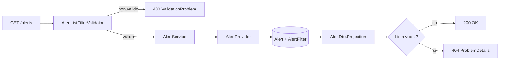
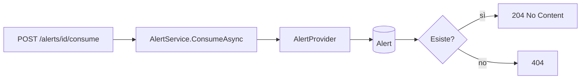

# Endpoint group: Alerts

## Introduzione

Un'**allerta** nasce quando una mail corrisponde a un filtro con il processo `Alert`. dr-mailroom non notifica nessuno: registra l'allerta e basta.

Il gruppo `Alerts` è pensato per un **software esterno** che:

1. legge le allerte non ancora notificate (`consumed=false`);
2. avvisa l'utente;
3. marca ogni allerta come consumata.

Tutti gli endpoint richiedono la chiave API nell'header `x-api-key`.

## Architettura

| Componente | File | Responsabilità |
|---|---|---|
| Mapping | `src/dr-mailroom-api/Endpoints/AlertsMapping.cs` | Route, metadati OpenAPI, validazione dei filtri |
| Validatore | `src/dr-mailroom-api/Validators/AlertListFilterValidator.cs` | Controllo dei filtri di ricerca |
| Servizio | `src/dr-mailroom-api/Services/AlertService.cs` | Consultazione e consumo |
| Provider | `AlertProvider` (in `src/dr-mailroom-core/Infrastructure/Mailroom/`) | Lettura e aggiornamento delle allerte |
| Entity | `Alert`, `AlertFilter` | Allerta e filtri che l'hanno generata |
| DTO | `AlertDto`, `AlertSummaryDto` | Risposte |

Accesso DB: sì. Servizi esterni: no.

## Descrizione endpoint

| Metodo | URL | Descrizione | Parametri | Risposta |
|---|---|---|---|---|
| GET | `/api/v1/alerts` | Allerte dalla più vecchia | Query: `consumed`, `mailboxId`, `senderAddress` (contiene), `receivedAtUtcFrom`, `receivedAtUtcTo` | 200 `List<AlertDto>` · 400 · 404 se vuoto |
| GET | `/api/v1/alerts/summary` | Elenco ridotto | Query: come sopra | 200 `List<AlertSummaryDto>` · 400 · 404 se vuoto |
| POST | `/api/v1/alerts/{id}/consume` | Marca l'allerta come notificata (`ConsumedAtUtc`). Idempotente | Route: `id` (long) | 204 · 404 |

## Flusso endpoint

### GET /api/v1/alerts (e /summary)

### POST /api/v1/alerts/{id}/consume

## Esempi

Per i casi d'uso fare riferimento a `src/dr-mailroom-api/dr-mailroom-api.http`.

---
*Revisione v1.0 — 2026-10-08 22:49 — claude-opus-5-5*
