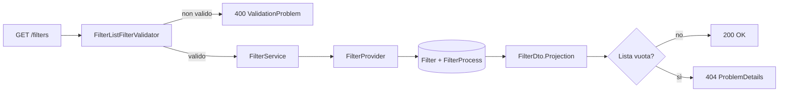
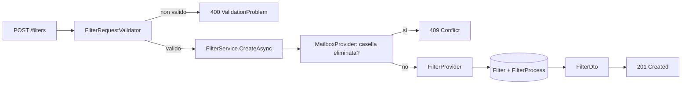
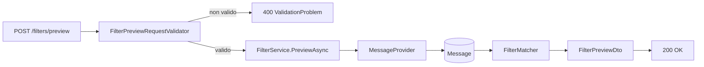
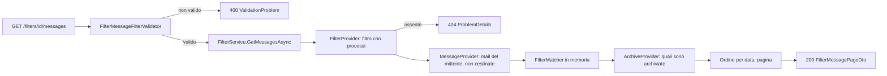
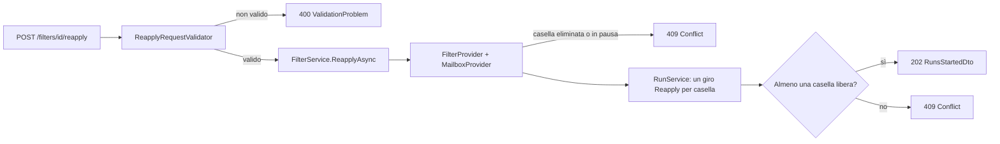

# Endpoint group: Filters

## Introduzione

Il gruppo `Filters` gestisce i filtri di lavorazione. Un filtro dice **quali mail** lavorare e **con quali processi**:

- mittente obbligatorio;
- al più una condizione sull'oggetto: `StartsWith`, `Contains` o `Regex`;
- almeno un processo: `AttachmentExtraction` (salva gli allegati), `Alert` (registra un'allerta), `ContentArchive` (salva il contenuto della mail come `.eml`, D22).

Un filtro vale sulle mail **nuove**. Per le mail già indicizzate ci sono tre strumenti:

- **anteprima**: prova la condizione senza scrivere nulla;
- **mail del filtro**: la tabella paginata delle mail che corrispondono a un filtro salvato, con lo stato del contenuto archiviato;
- **riapplica**: avvia un giro che lavora le mail già indicizzate.

Tutti gli endpoint richiedono la chiave API nell'header `x-api-key`.

## Architettura

| Componente | File | Responsabilità |
|---|---|---|
| Mapping | `src/dr-mailroom-api/Endpoints/FiltersMapping.cs` | Route, metadati OpenAPI, validazione |
| Validatori | `FilterListFilterValidator`, `FilterRequestValidator`, `FilterPreviewRequestValidator`, `ReapplyRequestValidator`, `FilterMessageFilterValidator` (in `src/dr-mailroom-api/Validators/`) | Controllo di filtri di ricerca, paginazione e body |
| Servizio | `src/dr-mailroom-api/Services/FilterService.cs` | CRUD, anteprima, mail del filtro, riapplica |
| Servizio collegato | `src/dr-mailroom-api/Services/RunService.cs` | Avvia i giri di riapplica |
| Provider | `FilterProvider`, `MailboxProvider`, `MessageProvider`, `ArchiveProvider` (in `src/dr-mailroom-core/Infrastructure/Mailroom/`) | Filtri, verifica della casella, mail indicizzate, contenuti archiviati |
| Dominio | `FilterMatcher` (in `src/dr-mailroom-core/Filtering/`) | Valuta mittente e condizione sull'oggetto |
| Entity | `Filter`, `FilterProcess`, `Message` | Filtro, processi associati, mail indicizzate |
| DTO | `FilterDto`, `FilterSummaryDto`, `FilterPreviewDto`, `MessageSummaryDto`, `FilterMessagePageDto`, `FilterMessageDto`, `RunsStartedDto` | Risposte |

Accesso DB: sì. Servizi esterni: no (la riapplica legge Gmail dentro il giro, non nella richiesta).

## Descrizione endpoint

| Metodo | URL | Descrizione | Parametri | Risposta |
|---|---|---|---|---|
| GET | `/api/v1/filters` | Elenco filtri completo | Query: `name`, `senderAddress`, `mailboxId`, `isEnabled` | 200 `List<FilterDto>` · 400 · 404 se vuoto |
| GET | `/api/v1/filters/summary` | Elenco filtri ridotto | Query: come sopra | 200 `List<FilterSummaryDto>` · 400 · 404 se vuoto |
| GET | `/api/v1/filters/{id}` | Dettaglio filtro con processi | Route: `id` (int) | 200 `FilterDto` · 404 |
| GET | `/api/v1/filters/{id}/messages` | Mail che corrispondono al filtro salvato, con lo stato del contenuto archiviato | Route: `id` (int) · Query: `sortDir` (`Asc`\|`Desc`, default `Desc`), `page` (da 1, default 1), `pageSize` (1–100, default 25) | 200 `FilterMessagePageDto` · 400 paginazione non valida · 404 filtro inesistente |
| POST | `/api/v1/filters` | Crea un filtro | Body `FilterRequest`: `name`, `senderAddress`, `mailboxId`, `subjectMatchType`, `subjectValue`, `attachmentSubfolder`, `isEnabled`, `processes` | 201 `FilterDto` · 400 (anche se `mailboxId` non esiste) · 409 se la casella è eliminata |
| PUT | `/api/v1/filters/{id}` | Sostituisce campi e processi | Route: `id` · Body `FilterRequest` | 204 · 400 (anche se `mailboxId` non esiste) · 404 · 409 se la casella è eliminata |
| DELETE | `/api/v1/filters/{id}` | Cancella il filtro; le allerte già create restano | Route: `id` (int) | 204 · 404 · 409 se la casella è eliminata |
| POST | `/api/v1/filters/preview` | Anteprima sulle mail indicizzate, senza scrivere | Body `FilterPreviewRequest`: `senderAddress`, `mailboxId`, `subjectMatchType`, `subjectValue` | 200 `FilterPreviewDto` (totale + le 50 mail più recenti) · 400 (anche se `mailboxId` non esiste) |
| POST | `/api/v1/filters/{id}/reapply` | Lavora le mail già indicizzate: sulla casella del filtro o, se il filtro vale per tutte, un giro per ogni casella attiva | Route: `id` · Body facoltativo `ReapplyRequest`: `processes` (sottoinsieme dei processi del filtro) | 202 `RunsStartedDto` · 400 se un processo non è del filtro · 404 · 409 se la casella è eliminata o in pausa, se non ci sono caselle attive o se tutte sono occupate |

## Flusso endpoint

### GET /api/v1/filters (e /summary)

### POST /api/v1/filters (PUT segue lo stesso schema)

### POST /api/v1/filters/preview

Ogni mail dell'anteprima (`MessageSummaryDto`) ha questi campi: `id`, `mailboxId`, `senderAddress`, `subject`, `receivedAtUtc`, `hasAttachments` e `isSent`.

`isSent` vale `true` per la posta inviata (label `SENT` o mittente uguale all'indirizzo della casella). Serve solo a segnalarla: un filtro lavora anche la posta inviata, anteprima e riapplica comprese (D20).

### GET /api/v1/filters/{id}/messages

- **Stesso confronto dell'anteprima**: il mittente si filtra in SQL, l'oggetto (anche `Regex`) si valuta in memoria con `FilterMatcher`. Per questo la paginazione si fa dopo il confronto. Le mail di un solo mittente sono al più qualche migliaio, quindi il costo è basso.
- **Filtro sospeso**: la tabella mostra comunque le sue corrispondenze.
- **Righe** (`FilterMessageDto`): `id`, `mailboxId`, `subject`, `receivedAtUtc`, `hasAttachments`, `isArchived`.
- **Pagina** (`FilterMessagePageDto`): `items`, `page`, `pageSize`, `totalCount`, poi:
  - `missingArchiveCount`: mail senza contenuto archiviato, su tutte le pagine;
  - `hasContentArchive`: vero se il filtro ha il processo `ContentArchive`, e quindi la riapplica può archiviarle.
- **Nessuna mail**: 200 con `totalCount` 0.

### POST /api/v1/filters/{id}/reapply

Il giro parte in background. Il suo avanzamento si legge con `GET /api/v1/runs/{id}` (vedi [endpoint-runs.md](endpoint-runs.md)).

## Esempi

Per i casi d'uso fare riferimento a `src/dr-mailroom-api/dr-mailroom-api.http`.

---
*Revisione v1.3 — 2026-10-13 23:05 — claude-opus-5-5*
