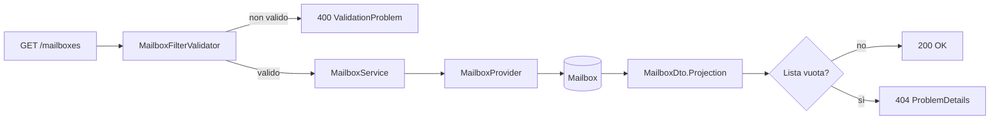
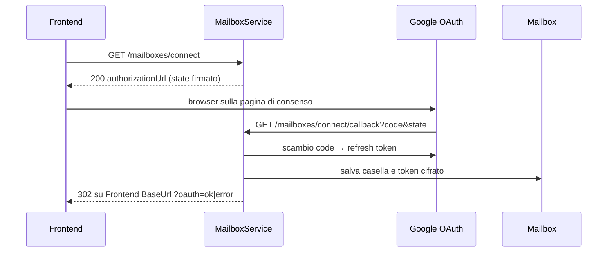
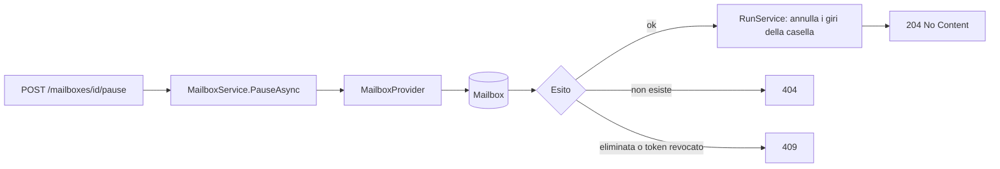

# Endpoint group: Mailboxes

## Introduzione

Il gruppo `Mailboxes` gestisce le caselle Gmail lette dal servizio. Permette di:

- elencare le caselle e vederne lo stato (token valido, backfill, ultimo giro, ultimo errore);
- collegare una nuova casella con il consenso OAuth di Google, in sola lettura;
- mettere in pausa e riprendere una casella;
- eliminare una casella in modo logico.

Tutti gli endpoint richiedono la chiave API nell'header `x-api-key`. L'unica eccezione è il callback OAuth: lo chiama il browser al ritorno da Google, quindi è anonimo.

## Architettura

| Componente | File | Responsabilità |
|---|---|---|
| Mapping | `src/dr-mailroom-api/Endpoints/MailboxesMapping.cs` | Route, metadati OpenAPI, validazione dei filtri |
| Validatore | `src/dr-mailroom-api/Validators/MailboxFilterValidator.cs` | Controlla i filtri di ricerca prima della query |
| Servizio | `src/dr-mailroom-api/Services/MailboxService.cs` | Consultazione, flusso OAuth, pausa, ripresa, eliminazione |
| Servizio collegato | `src/dr-mailroom-api/Services/RunService.cs` | Annulla i giri in corso quando la casella va in pausa |
| Provider | `MailboxProvider`, `RunProvider` (in `src/dr-mailroom-core/Infrastructure/Mailroom/`) | Accesso alle tabelle delle caselle e dei giri |
| Sicurezza | `IGmailAuthorizer`, `ITokenProtector`, `OAuthStateProtector` (in `dr-mailroom-core`) | URL di consenso, scambio del codice, cifratura del refresh token, firma dello `state` |
| Entity | `Mailbox` | Casella con stato e token cifrato |
| DTO | `MailboxDto` (con `MailboxRunDto` per il giro in corso), `MailboxSummaryDto`, `ConnectUrlDto` | Risposte; `MailboxDto` porta anche l'avanzamento del backfill (`messagesIndexed` su `messagesTotal`), il giro `Running` più recente (`currentRun`, null se nessuno) e `lastErrorRunId` |

Accesso DB: sì. Servizi esterni: sì, Google OAuth 2.0 (solo `connect` e `connect/callback`).

### Stati della casella

| Stato | Significato |
|---|---|
| `Active` | Entra nei giri |
| `Disabled` | In pausa: nessun giro (cron, manuale, riapplica) finché non si riprende |
| `TokenRevoked` | Google ha revocato il consenso: va ricollegata |
| `Deleted` | Eliminata logicamente: statistiche e storico restano |

## Descrizione endpoint

| Metodo | URL | Descrizione | Parametri | Risposta |
|---|---|---|---|---|
| GET | `/api/v1/mailboxes` | Elenco caselle completo | Query: `emailAddress`, `status` | 200 `List<MailboxDto>` · 400 · 404 se vuoto |
| GET | `/api/v1/mailboxes/summary` | Elenco caselle ridotto | Query: `emailAddress`, `status` | 200 `List<MailboxSummaryDto>` · 400 · 404 se vuoto |
| GET | `/api/v1/mailboxes/{id}` | Dettaglio casella | Route: `id` (int) | 200 `MailboxDto` · 404 |
| GET | `/api/v1/mailboxes/connect` | URL della pagina di consenso Google | — | 200 `ConnectUrlDto` (`authorizationUrl`) |
| GET | `/api/v1/mailboxes/connect/callback` | Ritorno da Google (anonimo), sia per il collegamento sia per il cestino: lo state firmato dice quale | Query: `code`, `state`, `error` | 302 verso il frontend con `oauth=ok` oppure `oauth=error` (per il cestino: sulla vista del mittente, con `reason=trash_mailbox_mismatch` se l'account Google non è quello della casella) |
| GET | `/api/v1/mailboxes/{id}/trash-authorization` | URL del consenso Google per il cestino (scope `gmail.modify`, token separato, D21) | Route: `id` (int); query: `sender` (facoltativo, la vista a cui tornare) | 200 `ConnectUrlDto` · 404 · 409 se la casella non è attiva |
| POST | `/api/v1/mailboxes/{id}/pause` | Mette in pausa la casella e annulla i suoi giri in corso. Idempotente | Route: `id` (int) | 204 · 404 · 409 se eliminata o con token revocato |
| POST | `/api/v1/mailboxes/{id}/resume` | Riprende una casella in pausa. Idempotente su `Active` | Route: `id` (int) | 204 · 404 · 409 se non è in pausa |
| DELETE | `/api/v1/mailboxes/{id}` | Eliminazione logica: stato `Deleted`, token rimosso. Idempotente su una casella già eliminata | Route: `id` (int) | 204 · 404 · 409 se un giro è in corso |

## Flusso endpoint

### GET /api/v1/mailboxes (e /summary)

### Collegamento di una casella (connect + callback)

### POST /api/v1/mailboxes/{id}/pause

`resume` e `DELETE` seguono lo stesso schema: servizio → provider → entity → 204, 404 o 409.

## Esempi

Per i casi d'uso fare riferimento a `src/dr-mailroom-api/dr-mailroom-api.http`.

---
*Revisione v1.3 — 2026-10-13 21:35 — claude-opus-5-5*
