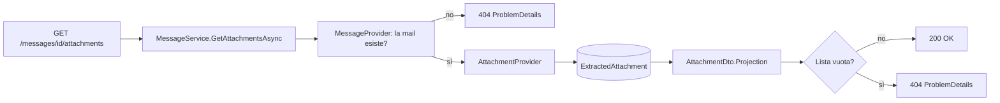

# Endpoint group: Messages

## Introduzione

Il gruppo `Messages` espone le mail indicizzate. Oggi ha un solo endpoint: gli **allegati salvati** di una mail.

Un allegato si salva quando la mail corrisponde a un filtro con il processo `AttachmentExtraction`. Il file sta sotto `Mailroom:Attachments:RootPath`. L'API restituisce il percorso relativo e l'hash SHA-256, non il contenuto del file.

Tutti gli endpoint richiedono la chiave API nell'header `x-api-key`.

## Architettura

| Componente | File | Responsabilità |
|---|---|---|
| Mapping | `src/dr-mailroom-api/Endpoints/MessagesMapping.cs` | Route e metadati OpenAPI |
| Servizio | `src/dr-mailroom-api/Services/MessageService.cs` | Verifica la mail e legge gli allegati |
| Provider | `MessageProvider`, `AttachmentProvider` (in `src/dr-mailroom-core/Infrastructure/Mailroom/`) | Mail indicizzate e allegati estratti |
| Entity | `Message`, `ExtractedAttachment` | Mail e allegato salvato |
| DTO | `AttachmentDto` | `id`, `partId`, `originalFileName`, `relativePath`, `sizeBytes`, `sha256`, `savedAtUtc` |

Accesso DB: sì. Servizi esterni: no.

## Descrizione endpoint

| Metodo | URL | Descrizione | Parametri | Risposta |
|---|---|---|---|---|
| GET | `/api/v1/messages/{id}/attachments` | Allegati salvati di una mail | Route: `id` (long) | 200 `List<AttachmentDto>` · 404 se la mail non esiste o non ha allegati salvati |

## Flusso endpoint

### GET /api/v1/messages/{id}/attachments

## Esempi

Per i casi d'uso fare riferimento a `src/dr-mailroom-api/dr-mailroom-api.http`.

---
*Revisione v1.0 — 2026-10-08 22:49 — claude-opus-5-5*
