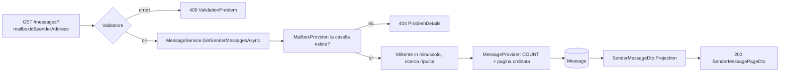
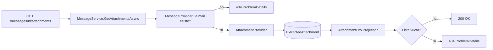

# Endpoint group: Messages

## Introduzione

Il gruppo `Messages` espone le mail indicizzate. Ha due endpoint:

- la **griglia delle mail di un mittente** in una casella, a pagine. La apre il frontend quando si seleziona un mittente nelle statistiche;
- gli **allegati salvati** di una mail.

Un allegato si salva quando la mail corrisponde a un filtro con il processo `AttachmentExtraction`. Il file sta sotto `Mailroom:Attachments:RootPath`. L'API restituisce il percorso relativo e l'hash SHA-256, non il contenuto del file.

Tutti gli endpoint richiedono la chiave API nell'header `x-api-key`.

## Architettura

| Componente | File | Responsabilità |
|---|---|---|
| Mapping | `src/dr-mailroom-api/Endpoints/MessagesMapping.cs` | Route e metadati OpenAPI |
| Validatore | `src/dr-mailroom-api/Validators/SenderMessageFilterValidator.cs` | Controlla i parametri della griglia prima della query |
| Servizio | `src/dr-mailroom-api/Services/MessageService.cs` | Verifica la casella, normalizza il mittente, legge la pagina; verifica la mail e legge gli allegati |
| Provider | `MessageProvider`, `AttachmentProvider`, `MailboxProvider` (in `src/dr-mailroom-core/Infrastructure/Mailroom/`) | Mail indicizzate, allegati estratti, esistenza della casella |
| Filtro | `SenderMessageFilter` (in `.../Mailroom/Filters/`) | Casella, mittente, ricerca nell'oggetto, verso, pagina |
| Entity | `Message`, `ExtractedAttachment` | Mail e allegato salvato |
| DTO | `SenderMessageDto` | `id`, `subject`, `receivedAtUtc`, `labels`, `hasAttachments` |
| DTO | `SenderMessagePageDto` | `items`, `page`, `pageSize`, `totalCount` |
| DTO | `AttachmentDto` | `id`, `partId`, `originalFileName`, `relativePath`, `sizeBytes`, `sha256`, `savedAtUtc` |

Accesso DB: sì. Servizi esterni: no.

## Descrizione endpoint

| Metodo | URL | Descrizione | Parametri | Risposta |
|---|---|---|---|---|
| GET | `/api/v1/messages` | Mail di un mittente in una casella | Query: `mailboxId` (obbligatorio), `senderAddress` (obbligatorio, max 320), `search` (facoltativo, max 1000), `sortDir` (`Asc`\|`Desc`, default `Desc`), `page` (da 1, default 1), `pageSize` (1–100, default 25) | 200 `SenderMessagePageDto` · 400 parametri non validi · 404 casella inesistente |
| GET | `/api/v1/messages/{id}/attachments` | Allegati salvati di una mail | Route: `id` (long) | 200 `List<AttachmentDto>` · 404 se la mail non esiste o non ha allegati salvati |

### Note sulla griglia delle mail

- **Mittente**: confrontato per uguaglianza, senza distinguere maiuscole e minuscole. Il servizio lo porta in minuscolo, come viene salvato. Non è richiesto un indirizzo email formalmente valido: la griglia deve aprirsi anche per i mittenti salvati così come arrivano da Gmail.
- **Ricerca**: cerca il testo dentro l'oggetto. Le mail senza oggetto non compaiono quando la ricerca è attiva.
- **Ordine**: per data di ricezione. A parità di data decide l'`id`, così le pagine restano stabili.
- **`labels`**: gli id delle label Gmail separati da virgola, così come salvati (es. `INBOX,CATEGORY_PROMOTIONS,Label_12`). La traduzione in testo leggibile la fa il frontend. Le label create dall'utente restano come id.
- **Nessuna mail**: 200 con `totalCount` 0 e `items` vuoto, non 404.
- **Indice**: la query usa l'indice esistente `(MailboxId, SenderAddress, ReceivedAtUtc)`.

## Flusso endpoint

### GET /api/v1/messages



### GET /api/v1/messages/{id}/attachments



## Esempi

```http
GET /api/v1/messages?mailboxId=1&senderAddress=newsletter@negozio.it&search=promozione&page=1&pageSize=25
x-api-key: {{apiKey}}
```

```json
{
  "items": [
    {
      "id": 4812,
      "subject": "Promozione d'autunno",
      "receivedAtUtc": "2026-10-02T08:14:00Z",
      "labels": "INBOX,CATEGORY_PROMOTIONS",
      "hasAttachments": false
    }
  ],
  "page": 1,
  "pageSize": 25,
  "totalCount": 1
}
```

Per gli altri casi d'uso fare riferimento a `src/dr-mailroom-api/dr-mailroom-api.http`.

---
*Revisione v1.1 — 2026-10-11 00:12 — claude-opus-5-5*
