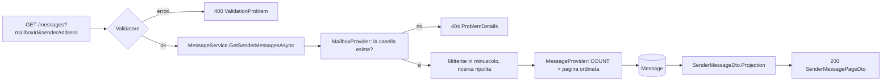
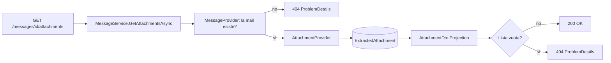
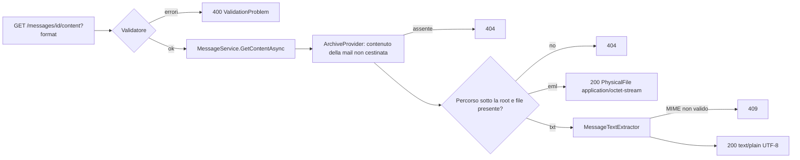
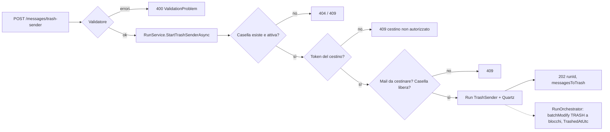

# Endpoint group: Messages

## Introduzione

Il gruppo `Messages` espone le mail indicizzate. Ha quattro endpoint:

- la **griglia delle mail di un mittente** in una casella, a pagine. La apre il frontend quando si seleziona un mittente nelle statistiche;
- gli **allegati salvati** di una mail;
- il **contenuto archiviato** di una mail, come `.eml` originale o come testo leggibile (D22);
- **"Elimina tutte"**: sposta nel cestino di Gmail le mail ricevute da un mittente (D21), anche solo quelle fino a una data.

Un allegato si salva quando la mail corrisponde a un filtro con il processo `AttachmentExtraction`. Il file sta sotto `Mailroom:Attachments:RootPath`. L'API restituisce il percorso relativo e l'hash SHA-256, non il contenuto del file.

Tutti gli endpoint richiedono la chiave API nell'header `x-api-key`.

## Architettura

| Componente | File | Responsabilità |
|---|---|---|
| Mapping | `src/dr-mailroom-api/Endpoints/MessagesMapping.cs` | Route e metadati OpenAPI |
| Validatore | `src/dr-mailroom-api/Validators/SenderMessageFilterValidator.cs` | Controlla i parametri della griglia prima della query |
| Validatore | `src/dr-mailroom-api/Validators/TrashSenderRequestValidator.cs` | Casella e mittente obbligatori per "Elimina tutte", data limite facoltativa |
| Validatore | `src/dr-mailroom-api/Validators/MessageContentQueryValidator.cs` | `format` obbligatorio: `eml` o `txt` |
| Servizio | `src/dr-mailroom-api/Services/RunService.cs` | "Elimina tutte": verifica casella, autorizzazione del cestino e mail da cestinare, poi crea e affida il giro `TrashSender` |
| Orchestratore e client | `RunOrchestrator`, `GmailTrasher` (in `src/dr-mailroom-core/`) | Cestina a blocchi da 1.000 con il token separato e marca `TrashedAtUtc` |
| Servizio | `src/dr-mailroom-api/Services/MessageService.cs` | Verifica la casella, normalizza il mittente, legge la pagina; verifica la mail e legge gli allegati; risolve il file del contenuto archiviato e ne ricava il testo |
| Provider | `MessageProvider`, `AttachmentProvider`, `ArchiveProvider`, `MailboxProvider` (in `src/dr-mailroom-core/Infrastructure/Mailroom/`) | Mail indicizzate, allegati estratti, contenuti archiviati, esistenza della casella |
| Dominio | `MessageTextExtractor` (in `src/dr-mailroom-core/Processes/`) | Dal `.eml` al testo: intestazioni, poi text/plain o l'HTML convertito |
| Filtro | `SenderMessageFilter` (in `.../Mailroom/Filters/`) | Casella, mittente, ricerca nell'oggetto, data limite, verso, pagina |
| Entity | `Message`, `ExtractedAttachment`, `ArchivedMessageContent` | Mail, allegato salvato, contenuto archiviato |
| DTO | `SenderMessageDto` | `id`, `gmailMessageId`, `subject`, `receivedAtUtc`, `labels`, `hasAttachments` |
| DTO | `SenderMessagePageDto` | `items`, `page`, `pageSize`, `totalCount` |
| DTO | `AttachmentDto` | `id`, `partId`, `originalFileName`, `relativePath`, `sizeBytes`, `sha256`, `savedAtUtc` |
| DTO | `TrashSenderRequest` / `TrashSenderStartedDto` | body `mailboxId`, `senderAddress`, `receivedBeforeUtc`, `withoutAttachmentsOnly` / risposta `runId`, `messagesToTrash` |

Accesso DB: sì. Servizi esterni: Gmail, solo per "Elimina tutte" (scope `gmail.modify`, token separato).

## Descrizione endpoint

| Metodo | URL | Descrizione | Parametri | Risposta |
|---|---|---|---|---|
| GET | `/api/v1/messages` | Mail di un mittente in una casella | Query: `mailboxId` (obbligatorio), `senderAddress` (obbligatorio, max 320), `search` (facoltativo, max 1000), `receivedBeforeUtc` (facoltativo, istante UTC, estremo escluso), `withoutAttachmentsOnly` (facoltativo, `true` = solo mail senza allegati), `sortDir` (`Asc`\|`Desc`, default `Desc`), `page` (da 1, default 1), `pageSize` (1–100, default 25) | 200 `SenderMessagePageDto` · 400 parametri non validi · 404 casella inesistente |
| GET | `/api/v1/messages/{id}/attachments` | Allegati salvati di una mail | Route: `id` (long) | 200 `List<AttachmentDto>` · 404 se la mail non esiste o non ha allegati salvati |
| GET | `/api/v1/messages/{id}/content` | Contenuto archiviato di una mail | Route: `id` (long) · Query: `format` (`eml`\|`txt`, obbligatorio, maiuscole indifferenti) | 200 file (`application/octet-stream` per `eml`, `text/plain; charset=utf-8` per `txt`) · 400 formato mancante o non valido · 404 mail inesistente o cestinata, contenuto non archiviato, file non più sul disco · 409 `.eml` non leggibile |
| POST | `/api/v1/messages/trash-sender` | "Elimina tutte": avvia il giro che sposta nel cestino le mail ricevute dal mittente | Body: `mailboxId`, `senderAddress` (max 320), `receivedBeforeUtc` (facoltativo, istante UTC, estremo escluso), `withoutAttachmentsOnly` (facoltativo, `true` = solo mail senza allegati) | 202 `TrashSenderStartedDto` · 400 · 404 casella inesistente · 409 casella non attiva, cestino non autorizzato, niente da cestinare o casella occupata |

### Note sulla griglia delle mail

- **Mittente**: confrontato per uguaglianza, senza distinguere maiuscole e minuscole. Il servizio lo porta in minuscolo, come viene salvato. Non è richiesto un indirizzo email formalmente valido: la griglia deve aprirsi anche per i mittenti salvati così come arrivano da Gmail.
- **Ricerca**: cerca il testo dentro l'oggetto. Le mail senza oggetto non compaiono quando la ricerca è attiva.
- **Ordine**: per data di ricezione. A parità di data decide l'`id`, così le pagine restano stabili.
- **`labels`**: gli id delle label Gmail separati da virgola, così come salvati (es. `INBOX,CATEGORY_PROMOTIONS,Label_12`). La traduzione in testo leggibile la fa il frontend. Le label create dall'utente restano come id.
- **Nessuna mail**: 200 con `totalCount` 0 e `items` vuoto, non 404.
- **Indice**: la query usa l'indice esistente `(MailboxId, SenderAddress, ReceivedAtUtc)`.
- **Mail cestinate**: quelle spostate nel cestino con "Elimina tutte" (`TrashedAtUtc` valorizzato) non compaiono.
- **`receivedBeforeUtc`**: solo le mail ricevute prima di quell'istante. Il frontend lo usa per contare le mail di "Elimina tutte" fino a una data.
- **`withoutAttachmentsOnly`**: solo le mail senza allegati. Il frontend lo usa per contare le mail di "Elimina senza 📎".
- **`gmailMessageId`**: id Gmail della mail; il frontend ci costruisce il link "Apri in Gmail" (`https://mail.google.com/mail/u/?authuser=<casella>#all/<gmailMessageId>`).

### Note sul contenuto archiviato

- **Da dove viene**: lo salva il processo `ContentArchive` di un filtro (D22) come `.eml` sotto `Mailroom:Attachments:RootPath`, nella sottocartella del filtro. Le mail precedenti al processo si archiviano con la riapplica del filtro limitata a `ContentArchive`.
- **`eml`**: il messaggio originale, servito in streaming dal disco.
- **`txt`**: si ricava dal `.eml` a ogni richiesta, non si salva. In testa ci sono Da, Oggetto e Data, poi il corpo text/plain. Se la mail ha solo HTML, il testo viene dall'HTML convertito: si tolgono script, stili e `<head>` e si va a capo sui tag di blocco.
- **Sicurezza**: il percorso viene solo dal DB e deve risolversi sotto la root; altrimenti 404, con un avviso nel log. La risposta ha sempre `Content-Disposition: attachment` e `X-Content-Type-Options: nosniff`: il browser non apre mai l'HTML della mail.

### Note su "Elimina tutte"

- **Quali mail**: quelle ricevute dal mittente nella casella e non ancora cestinate. Le mail inviate a quell'indirizzo (`IsSent`) restano. La ricerca per oggetto della griglia non conta: vale per tutte.
- **Fino a una data**: con `receivedBeforeUtc` vanno nel cestino solo le mail ricevute prima di quell'istante, le successive restano. Per "fino al 1 gennaio 2026 compreso" il frontend invia l'inizio del 2 gennaio in ora locale (`2026-01-01T23:00:00Z` in Italia). Il limite è salvato su `Run.TrashReceivedBeforeUtc` e restituito in `RunDto.trashReceivedBeforeUtc`. Se nessuna mail rientra nel limite, la risposta è 409 "niente da cestinare".
- **Solo senza allegati** ("Elimina senza 📎"): con `withoutAttachmentsOnly: true` restano le mail con allegati (`Message.HasAttachments`). Il flag è salvato su `Run.TrashWithoutAttachmentsOnly` e restituito in `RunDto.trashWithoutAttachmentsOnly`; si combina con `receivedBeforeUtc`.
- **Dove finiscono**: nel cestino di Gmail, recuperabili da Gmail per 30 giorni. dr-mailroom non elimina mai definitivamente in Gmail e non offre un "ripristina".
- **Autorizzazione**: senza il token del cestino il servizio risponde 409. Il frontend legge `MailboxDto.trashAuthorized` e, se serve, porta l'utente al consenso con `GET /api/v1/mailboxes/{id}/trash-authorization`.
- **Avanzamento**: si segue con `GET /api/v1/runs/{runId}`. `messagesRead` = mail trovate, `messagesProcessed` = mail già nel cestino, aggiornati a ogni blocco.

## Flusso endpoint

### GET /api/v1/messages



### GET /api/v1/messages/{id}/attachments



### GET /api/v1/messages/{id}/content



### POST /api/v1/messages/trash-sender



## Esempi

```http
GET /api/v1/messages?mailboxId=1&senderAddress=newsletter@negozio.it&search=promozione&page=1&pageSize=25
x-api-key: {{apiKey}}
```

```json
{
  "items": [
    {
      "id": 4812,
      "gmailMessageId": "18c2f0a1b2c3d4e5",
      "subject": "Promozione d'autunno",
      "receivedAtUtc": "2026-10-02T08:14:00Z",
      "labels": "INBOX,CATEGORY_PROMOTIONS",
      "hasAttachments": false
    }
  ],
  "page": 1,
  "pageSize": 25,
  "totalCount": 1
}
```

Per gli altri casi d'uso fare riferimento a `src/dr-mailroom-api/dr-mailroom-api.http`.

---
*Revisione v1.4 — 2026-10-21 22:45 — claude-opus-5-5 — `withoutAttachmentsOnly`, `gmailMessageId`*
