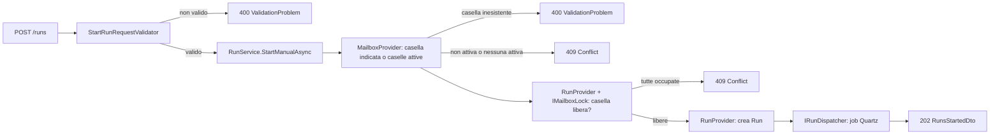
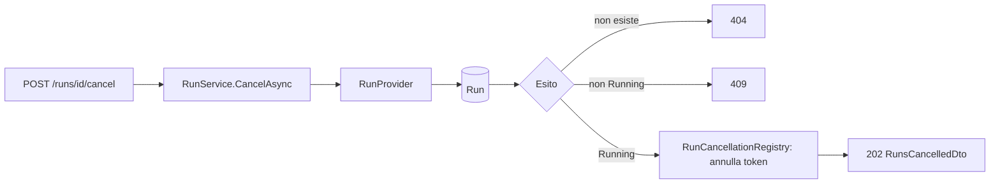
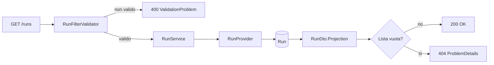

# Endpoint group: Runs

## Introduzione

Un **giro** è un passaggio del servizio su una casella: legge le mail nuove da Gmail, aggiorna le statistiche e applica filtri e processi. Al primo giro indicizza tutto lo storico (backfill).

I giri partono in tre modi (`RunTrigger`):

| Origine | Chi lo avvia |
|---|---|
| `Scheduled` | Il cron Quartz (`Mailroom:Schedule:Cron`) |
| `Manual` | `POST /api/v1/runs` |
| `Reapply` | `POST /api/v1/filters/{id}/reapply` |

Il gruppo `Runs` permette di avviare un giro subito, annullarlo e consultarne la cronologia. Una casella ha **al più un giro alla volta**: se è occupata la risposta è 409.

Tutti gli endpoint richiedono la chiave API nell'header `x-api-key`.

## Architettura

| Componente | File | Responsabilità |
|---|---|---|
| Mapping | `src/dr-mailroom-api/Endpoints/RunsMapping.cs` | Route, metadati OpenAPI, validazione |
| Validatori | `StartRunRequestValidator`, `RunFilterValidator` (in `src/dr-mailroom-api/Validators/`) | Controllo di body e filtri di ricerca |
| Servizio | `src/dr-mailroom-api/Services/RunService.cs` | Avvio, annullamento, consultazione |
| Provider | `RunProvider`, `MailboxProvider` (in `src/dr-mailroom-core/Infrastructure/Mailroom/`) | Giri e caselle attive |
| Lock | `IMailboxLock` / `MailboxLock` (in `src/dr-mailroom-core/Runs/`) | Un solo giro per casella |
| Dispatcher | `IRunDispatcher` / `QuartzRunDispatcher` (in `src/dr-mailroom-api/Scheduling/`) | Accoda il giro come job Quartz |
| Annullamento | `RunCancellationRegistry` (in `src/dr-mailroom-core/Runs/`) | Token di annullamento dei giri in corso |
| Entity | `Run` | Giro con stato e contatori |
| DTO | `RunDto`, `RunSummaryDto`, `RunsStartedDto`, `RunsCancelledDto` | Risposte |

Accesso DB: sì. Servizi esterni: no nella richiesta. Il giro, eseguito in background da Quartz, legge Gmail.

### Stati del giro

| Stato | Significato |
|---|---|
| `Running` | In corso |
| `Completed` | Terminato |
| `Failed` | Terminato con errore, oppure interrotto da un arresto brusco (chiuso all'avvio successivo) |
| `Skipped` | Non eseguito: al momento di partire la casella era eliminata, in pausa oppure occupata da un altro giro |
| `Cancelled` | Annullato via API o all'arresto del servizio |

## Descrizione endpoint

| Metodo | URL | Descrizione | Parametri | Risposta |
|---|---|---|---|---|
| POST | `/api/v1/runs` | Avvia subito un giro su una casella o, senza `mailboxId`, su tutte le caselle attive | Body facoltativo `StartRunRequest`: `mailboxId` | 202 `RunsStartedDto` (`runIds`, `skippedMailboxIds`) · 400 se la casella non esiste · 409 se la casella non è attiva, se non ci sono caselle attive o se la casella (o tutte) ha già un giro |
| POST | `/api/v1/runs/cancel` | Annulla tutti i giri `Running`. Non mette in pausa le caselle | — | 202 `RunsCancelledDto` (`runIds`) · 409 se nessun giro è in corso |
| POST | `/api/v1/runs/{id}/cancel` | Annulla un giro in corso. Il backfill riprende dalla pagina salvata | Route: `id` (long) | 202 `RunsCancelledDto` · 404 · 409 se non è in corso |
| GET | `/api/v1/runs` | Cronologia giri, dal più recente | Query: `mailboxId`, `trigger`, `status`, `startedAtUtcFrom`, `startedAtUtcTo` | 200 `List<RunDto>` · 400 · 404 se vuoto |
| GET | `/api/v1/runs/summary` | Cronologia ridotta | Query: come sopra | 200 `List<RunSummaryDto>` · 400 · 404 se vuoto |
| GET | `/api/v1/runs/{id}` | Stato e contatori del giro, da interrogare in polling | Route: `id` (long) | 200 `RunDto` · 404 |

L'annullamento è **asincrono**: il 202 conferma la richiesta. Il lavoro si ferma entro pochi secondi e il giro passa a `Cancelled`. Lo si verifica con `GET /api/v1/runs/{id}`.

## Flusso endpoint

### POST /api/v1/runs

### POST /api/v1/runs/{id}/cancel

### GET /api/v1/runs (e /summary)

## Esempi

Per i casi d'uso fare riferimento a `src/dr-mailroom-api/dr-mailroom-api.http`.

---
*Revisione v1.1 — 2026-10-08 23:03 — claude-opus-5-5*
