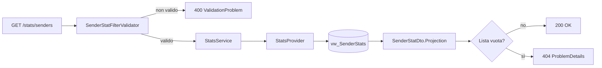

# Endpoint group: Stats

## Introduzione

Il gruppo `Stats` restituisce quante mail ha mandato ogni mittente, per casella:

- in totale;
- mese per mese (`YearMonth` nel formato `yyyyMM`, per esempio `202610`).

Il conteggio riguarda **tutte** le mail lette, non solo quelle filtrate. È in sola lettura.

Tutti gli endpoint richiedono la chiave API nell'header `x-api-key`.

## Architettura

| Componente | File | Responsabilità |
|---|---|---|
| Mapping | `src/dr-mailroom-api/Endpoints/StatsMapping.cs` | Route, metadati OpenAPI, validazione dei filtri |
| Validatori | `SenderStatFilterValidator`, `SenderMonthlyStatFilterValidator` (in `src/dr-mailroom-api/Validators/`) | Controllo dei filtri di ricerca |
| Servizio | `src/dr-mailroom-api/Services/StatsService.cs` | Sceglie la proiezione e chiama il provider |
| Provider | `StatsProvider` (in `src/dr-mailroom-core/Infrastructure/Mailroom/`) | Lettura delle statistiche |
| Entity | `SenderStat`, `SenderMonthlyStat` | Conteggi, esposti dalle viste `vw_SenderStats` e `vw_SenderMonthlyStats` |
| DTO | `SenderStatDto`, `SenderMonthlyStatDto` | Risposte |

Accesso DB: sì. Servizi esterni: no.

## Descrizione endpoint

| Metodo | URL | Descrizione | Parametri | Risposta |
|---|---|---|---|---|
| GET | `/api/v1/stats/senders` | Mail per mittente e casella, dal più attivo | Query: `mailboxId`, `senderAddress` (contiene) | 200 `List<SenderStatDto>` (`mailboxId`, `senderAddress`, `mailCount`) · 400 · 404 se vuoto |
| GET | `/api/v1/stats/senders/monthly` | Mail per mittente, casella e mese | Query: `mailboxId`, `senderAddress` (contiene), `yearMonthFrom`, `yearMonthTo` | 200 `List<SenderMonthlyStatDto>` (`+ yearMonth`) · 400 · 404 se vuoto |

## Flusso endpoint

### GET /api/v1/stats/senders (monthly segue lo stesso schema)

## Esempi

Per i casi d'uso fare riferimento a `src/dr-mailroom-api/dr-mailroom-api.http`.

---
*Revisione v1.0 — 2026-10-08 22:49 — claude-opus-5-5*
