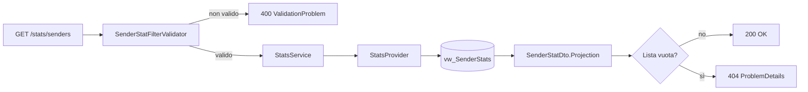
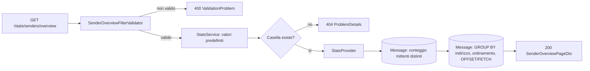

# Endpoint group: Stats

## Introduzione

Il gruppo `Stats` dice quante mail ha mandato ogni mittente, per casella:

- in totale;
- mese per mese (`YearMonth` nel formato `yyyyMM`, per esempio `202610`);
- in una **panoramica paginata**, con la mail più vecchia e la più recente di ogni mittente (data e oggetto);
- **anno per anno**, per tutta la casella o per un solo mittente.

Il conteggio riguarda **tutte** le mail lette, non solo quelle filtrate. Il gruppo è in sola lettura.

Il mittente è **sempre il suo indirizzo email**, mai il nome visualizzato: due mail con nomi diversi dallo stesso indirizzo contano per lo stesso mittente.

Tutti gli endpoint richiedono la chiave API nell'header `x-api-key`.

## Architettura

| Componente | File | Responsabilità |
|---|---|---|
| Mapping | `src/dr-mailroom-api/Endpoints/StatsMapping.cs` | Route, metadati OpenAPI, validazione dei filtri |
| Validatori | `SenderStatFilterValidator`, `SenderMonthlyStatFilterValidator`, `SenderOverviewFilterValidator`, `YearStatFilterValidator` (in `src/dr-mailroom-api/Validators/`) | Controllo dei filtri di ricerca |
| Servizio | `src/dr-mailroom-api/Services/StatsService.cs` | Valori predefiniti, normalizzazione dell'indirizzo, 404 sulla casella inesistente |
| Provider | `StatsProvider` (in `src/dr-mailroom-core/Infrastructure/Mailroom/`) | Lettura delle statistiche |
| Filtri | `SenderOverviewFilter`, `YearStatFilter` (in `src/dr-mailroom-core/Infrastructure/Mailroom/Filters/`) | Parametri di query |
| Entity | `SenderStat`, `SenderMonthlyStat` | Conteggi delle viste `vw_SenderStats` e `vw_SenderMonthlyStats` |
| Modelli | `SenderOverview`, `SenderOverviewPage`, `YearStat` (in `SenderOverview.cs`) | Righe calcolate dalla tabella `Message` |
| DTO | `SenderStatDto`, `SenderMonthlyStatDto`, `SenderOverviewDto`, `SenderOverviewPageDto`, `YearStatDto` | Risposte |

Accesso DB: sì. Servizi esterni: no.

## Descrizione endpoint

| Metodo | URL | Descrizione | Parametri | Risposta |
|---|---|---|---|---|
| GET | `/api/v1/stats/senders` | Mail per mittente e casella, dal più attivo | Query: `mailboxId`, `senderAddress` (contiene) | 200 `List<SenderStatDto>` (`mailboxId`, `senderAddress`, `mailCount`) · 400 · 404 se vuoto |
| GET | `/api/v1/stats/senders/monthly` | Mail per mittente, casella e mese | Query: `mailboxId`, `senderAddress` (contiene), `yearMonthFrom`, `yearMonthTo` | 200 `List<SenderMonthlyStatDto>` (`+ yearMonth`) · 400 · 404 se vuoto |
| GET | `/api/v1/stats/senders/overview` | Panoramica paginata dei mittenti di una casella | Query: vedi sotto | 200 `SenderOverviewPageDto` · 400 · 404 se la casella non esiste |
| GET | `/api/v1/stats/years` | Mail per anno della casella o di un mittente | Query: `mailboxId` (obbligatorio), `senderAddress` (uguale) | 200 `List<YearStatDto>` · 400 · 404 se la casella non esiste |

### Panoramica mittenti: parametri

| Parametro | Obbligatorio | Valori ammessi | Predefinito | Note |
|---|---|---|---|---|
| `mailboxId` | sì | intero > 0 | — | Casella inesistente → 404 |
| `year` | no | da 1970 all'anno corrente + 1 | tutto lo storico | Limita conteggi, date e oggetti a quell'anno |
| `search` | no | max 320 caratteri | nessuna ricerca | Cerca solo nell'**indirizzo** ("contiene"); maiuscole e minuscole indifferenti |
| `sortBy` | no | `MailCount`, `LastReceivedAt`, `FirstReceivedAt`, `SenderAddress` | `MailCount` | A parità si ordina per indirizzo, così le pagine restano stabili |
| `sortDir` | no | `Asc`, `Desc` | `Desc` (`Asc` con `SenderAddress`) | |
| `page` | no | intero ≥ 1 | 1 | Una pagina oltre l'ultima restituisce `items` vuoto |
| `pageSize` | no | da 1 a 100 | 25 | |

Un valore non ammesso per `sortBy` o `sortDir` viene respinto con 400 già dal binding dei parametri, prima del validatore.

### Panoramica mittenti: risposta

`SenderOverviewPageDto`:

| Campo | Significato |
|---|---|
| `items` | Righe della pagina (`SenderOverviewDto`) |
| `page`, `pageSize` | Pagina e dimensione usate, compresi i valori predefiniti |
| `totalCount` | Numero di mittenti che rispettano `year` e `search` |

`SenderOverviewDto`:

| Campo | Significato |
|---|---|
| `senderAddress` | Indirizzo del mittente, in minuscolo |
| `senderName` | Ultimo nome visualizzato non vuoto; solo informativo |
| `mailCount` | Mail del mittente nel periodo |
| `firstReceivedAtUtc`, `firstSubject` | Data e oggetto della mail più vecchia |
| `lastReceivedAtUtc`, `lastSubject` | Data e oggetto della mail più recente |

Due mail ricevute nello stesso istante si distinguono per l'Id interno: la più vecchia è quella salvata prima.

Una casella esistente ma senza mail (o una ricerca senza risultati) risponde **200** con `totalCount: 0` e `items` vuoto, non 404.

```json
{
  "items": [
    {
      "senderAddress": "newsmail@cdjapan.jp",
      "senderName": "CDJapan",
      "mailCount": 883,
      "firstReceivedAtUtc": "2025-02-03T13:30:36",
      "firstSubject": "Game New Release Updates_2025_02_03_Mon",
      "lastReceivedAtUtc": "2026-10-10T12:19:32",
      "lastSubject": "Anime Collectibles New Release Updates_2026_10_10_Sat"
    }
  ],
  "page": 1,
  "pageSize": 25,
  "totalCount": 2440
}
```

### Mail per anno

- `senderAddress` si confronta per **uguaglianza** (non "contiene"), dopo averlo portato in minuscolo.
- La risposta è ordinata dall'anno più recente: `[{ "year": 2026, "mailCount": 243 }, { "year": 2025, "mailCount": 87 }]`.
- Nessuna mail → **200** con lista vuota.

## Flusso endpoint

### GET /api/v1/stats/senders (monthly segue lo stesso schema)



### GET /api/v1/stats/senders/overview (years segue lo stesso schema)



## Come è calcolata la panoramica

La panoramica non usa le viste: legge la tabella `Message` con due query.

1. Conta i mittenti distinti che rispettano `year` e `search` (`totalCount`).
2. Raggruppa per indirizzo (conteggio, data minima e massima), ordina, pagina in SQL e legge nome e oggetti con sottoquery correlate.

Il filtro per anno è un intervallo su `ReceivedAtUtc` (`>= 1 gennaio` e `< 1 gennaio dell'anno dopo`), non su `YearMonth`.

L'indice `IX_Message_MailboxId_SenderAddress_ReceivedAtUtc` (`MailboxId`, `SenderAddress`, `ReceivedAtUtc`, con `Subject` incluso) copre raggruppamento, date e oggetti. È stato aggiunto dalla migration `20261010184202_SenderOverviewIndex`.

| Richiesta (casella da circa 38.000 mail) | Tempo misurato, al netto del trasporto |
|---|---|
| Panoramica, qualsiasi ordinamento | circa 50–75 ms |
| Panoramica con `year` | circa 45 ms |
| `stats/years` | circa 25 ms |
| Panoramica con `search` | circa 400 ms |

> ⚠️ **Limite noto: la ricerca è più lenta.** `search` diventa `LIKE '%testo%'`, che non può usare l'indice e scorre tutte le mail della casella. È accettato: il frontend invia la ricerca solo dopo una pausa nella digitazione.

## Esempi

```http
GET /api/v1/stats/senders/overview?mailboxId=1&year=2025&sortBy=LastReceivedAt&page=2
x-api-key: {{apiKey}}

GET /api/v1/stats/years?mailboxId=1&senderAddress=newsmail@cdjapan.jp
x-api-key: {{apiKey}}
```

Per gli altri casi d'uso fare riferimento a `src/dr-mailroom-api/dr-mailroom-api.http`.

---
*Revisione v1.1 — 2026-10-10 21:05 — claude-opus-5-5*
