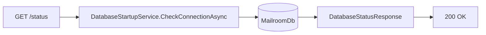
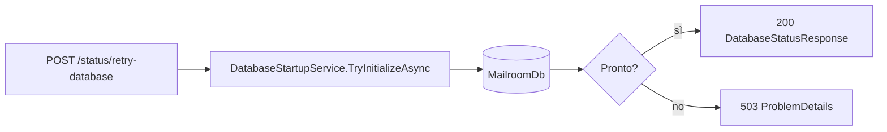

# Endpoint group: Status

## Introduzione

Il gruppo `Status` dice se il servizio può lavorare. Ha due livelli:

- `/health` controlla solo che il processo risponda. Serve all'infrastruttura (Docker, monitor) e non compare in Scalar.
- `api/v1/status` controlla il database. Serve al frontend e agli operatori.

Tutti gli endpoint del gruppo sono **anonimi**: devono rispondere anche quando il database non è disponibile.

## Architettura

| Componente | File | Responsabilità |
|---|---|---|
| Mapping | `src/dr-mailroom-api/Endpoints/HealthMapping.cs` | Registra `/health` e il gruppo `api/v1/status` |
| Servizio | `src/dr-mailroom-api/Infrastructure/Database/DatabaseStartupService.cs` | Prova la connessione, applica l'inizializzazione, ricorda l'ultimo errore |
| DTO | `src/dr-mailroom-api/Dto/DatabaseStatusResponse.cs` | `DatabaseReady`, `LastError`, `LastCheckedUtc` |

Accesso DB: sì, tramite `MailroomDbContext` (solo verifica di connessione e inizializzazione). Servizi esterni: no.

All'avvio, se il database non risponde, l'API parte lo stesso in **stato degradato**. Questi endpoint restano raggiungibili e permettono di ritentare.

## Descrizione endpoint

| Metodo | URL | Descrizione | Parametri | Risposta |
|---|---|---|---|---|
| GET | `/health` | Salute del processo | — | 200 `Healthy` |
| GET | `/api/v1/status` | Verifica live del database | — | 200 `DatabaseStatusResponse` (sempre 200, anche a DB giù) |
| POST | `/api/v1/status/retry-database` | Ritenta connessione e inizializzazione | — | 200 `DatabaseStatusResponse` se pronto · 503 `ProblemDetails` se ancora giù |

## Flusso endpoint

### GET /api/v1/status

### POST /api/v1/status/retry-database

## Esempi

Per i casi d'uso fare riferimento a `src/dr-mailroom-api/dr-mailroom-api.http`.

---
*Revisione v1.0 — 2026-10-08 23:03 — claude-opus-5-5*
